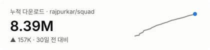
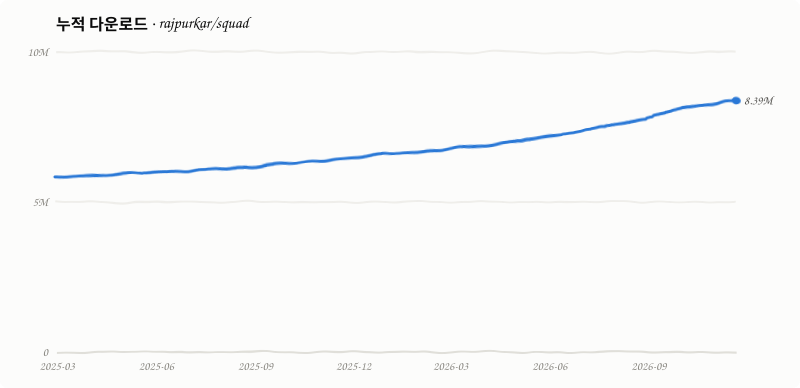
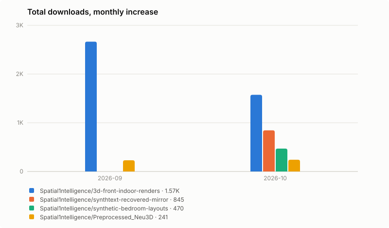
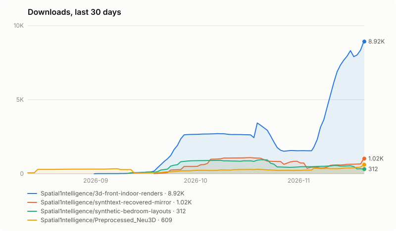
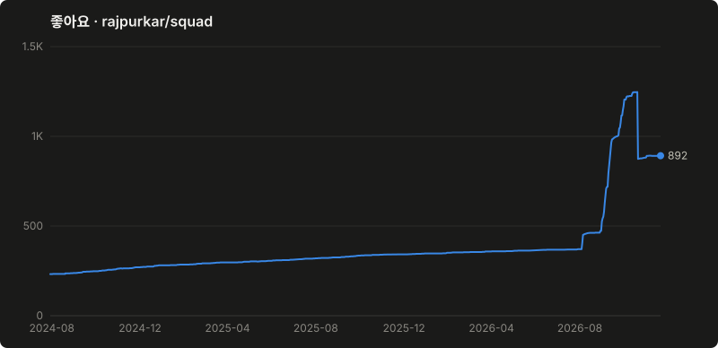

# huggingface-history

Hugging Face 저장소의 다운로드·좋아요처럼 현재값만 제공되는 지표를 날짜별로 쌓아 두고 차트로 보여 준다.
기록은 `data/ledger.csv`에 추가만 되므로 Hugging Face 쪽 값이 리셋돼도 남는다.

<!-- charts -->









<!-- /charts -->

## Hugging Face 카드에 넣기

아래를 Hugging Face 데이터셋(또는 모델) 카드의 `README.md` 본문에 붙여 넣는다.
주소가 고정이라 한 번만 넣으면 되고, 차트는 매일 갱신된다.
이 GitHub 저장소가 공개여야 그림이 보인다.

<!-- embed -->
```markdown


```
<!-- /embed -->

## 내 저장소에서 쓰기

1. 이 저장소에서 **Use this template**으로 새 저장소를 만든다.
2. `data/`와 `charts/`를 지운다. 이 저장소가 모은 기록이다.
3. `targets.toml`에 추적할 대상과 지표, README에 실을 차트를 적는다.
4. Actions 탭에서 워크플로를 켜고 `collect`를 한 번 수동 실행한다.

그 뒤로는 매일 03:17 UTC에 현재값을 기록하고 차트와 README를 갱신해 커밋한다.
첫 실행은 공개 스냅샷(`cfahlgren1/hub-stats`)에서 2024-07-29 이후의 과거 기록을 채우느라 20분쯤 걸린다.
과거 기록을 채울 수 없는 대상은 수집을 시작한 날부터 기록이 쌓인다.
비공개 저장소를 추적하려면 `HF_TOKEN` 시크릿을 넣는다.

## 직접 실행

```bash
./hfhist.py collect    # 현재값 기록
./hfhist.py backfill   # 현재값 기록 + 과거 채우기 (--step N, --all)
./hfhist.py chart      # 차트와 이 README의 차트 구간 갱신
```

`uv`가 필요하다. 대상을 처음 넣었을 때 과거가 없으면 차트는 수집 시작일부터 그려진다.
