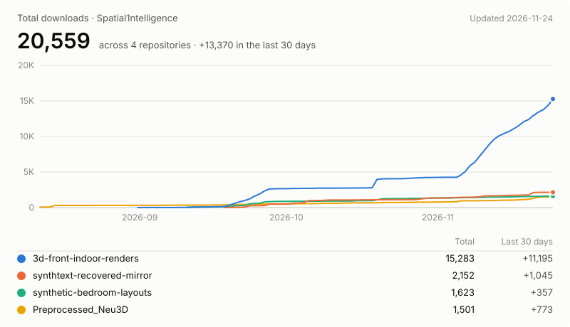

# huggingface-history

Hugging Face shows only the current value of metrics such as downloads and likes.
This project records them every day and draws the history as charts.
Records are only ever appended to `data/ledger.csv`, so they survive even if the numbers on Hugging Face are reset.

<!-- charts -->

<!-- /charts -->

## Embed in a Hugging Face card

Paste the block below into the body of a dataset, model, or organization card (`README.md`).
The URLs are stable, so you paste once and the charts update daily.
The GitHub repository must be public for the images to load.

<!-- embed -->
```markdown

```
<!-- /embed -->

## Use it for your own repositories

1. Create a repository from this one with **Use this template**.
2. Delete `data/` and `charts/`. They hold this repository's records.
3. Edit `targets.toml`: what to track, which metrics to record, and which charts to show.
4. Enable workflows in the Actions tab and run `collect` once by hand.

From then on it runs daily at 03:17 UTC: it records the current values, redraws the charts, updates this README, and commits.
The first run also fills in the past from the public snapshots in `cfahlgren1/hub-stats`, which go back to 2024-07-29. That can take up to about 20 minutes.
A target whose past cannot be filled starts its history on the day collection begins.
To track private repositories, add an `HF_TOKEN` secret.

## Run locally

```bash
./hfhist.py collect    # record current values
./hfhist.py backfill   # record current values and fill in the past (--step N, --all)
./hfhist.py chart      # redraw the charts and the chart blocks of this README
```

Requires `uv`. Design notes and decisions are in `PLAN.md`.
